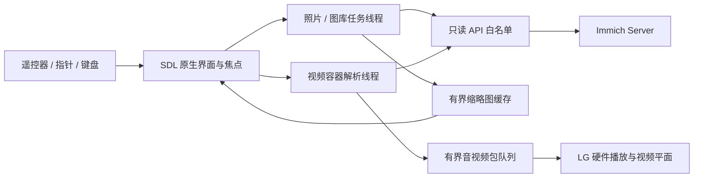

# 设计与实现

## 电视上的主要任务

进入自己的图库，找到想重温的照片或相册，然后留在全屏播放。
首屏按拍摄时间排列，侧栏只保留照片、相册、收藏、视频和连接设置。
不引入上传、整理、管理或社区功能。收藏页只查看服务器已有收藏。

视觉使用深色底、低亮度边栏、较大的照片缩略图与清晰的浅蓝焦点。
1920×1080 逻辑画布，侧栏宽 240，内容区从 x=304 到 x=1840。
取消各分类重复的大横幅，让照片直接进入首屏；标题、日期、工具栏与操作提示统一对齐。
照片和收藏使用 5 列 3 行，首屏显示 15 项；相册和视频使用 3 列 2 行，封面更大。
卡片、指针命中范围、方向键列数与滚动行数由同一套布局参数计算，间隙不响应点击。
连接设置使用左侧表单、右侧连接说明与幻灯片设置，表单内用标题和副说明区分层级。
页面保留全屏进入前的选中资源；切换照片后返回会把当前位置滚回可见范围。
方向键不跨行绕回，尾行不足一整行时下移落到该行最后一项。
返回顺序是键盘 → 视频 → 照片全屏 → 相册内容 → 侧栏 → 退出确认。

图标以 SVG 保存，经 NanoSVG 高分辨率栅格化后缓存为 SDL 纹理。
圆角、圆形与焦点环使用带像素覆盖率的距离场遮罩，每个形状一次绘制，避免缩放接缝。
文字测量可见字形范围，按钮、导航、标签与键盘共用对齐函数，不依赖字体上下留白。

## 模块

| 文件 | 责任 |
| --- | --- |
| `core.c` | 数据类型、API 路径策略、解析、网格移动、本机配置 |
| `api.c` | 动态加载 libcurl、TLS、认证头、只读端点、Range 读取 |
| `worker.c` | 图库请求、图片下载与解码；跨页面结果按代次丢弃 |
| `ui.c` | 页面、焦点、照片查看、幻灯片、缓存与输入行为 |
| `ui-paint.c` / `vector.c` | 抗锯齿圆角遮罩、SVG 加载与纹理缓存 |
| `demux.c` | 有界 Range 缓存、FFmpeg 容器解析、Annex B / ADTS、跳转 |
| `media-webos.c` | 主线程硬件调用、播放状态、暂停、跳转与卸载 |
| `media.c` / `proxy.c` | 桌面预览；只对 loopback 开放单段视频的临时授权通道 |
| `main.c` | 生命周期、LG / 桌面不同的 SDL 事件布局、正式 / QA 参数边界 |
| `vendor/starfish.*` | PlxNative 的 LG ABI 与回调生命周期适配器 |

网络与图片解码不在渲染线程执行。UI 线程拥有 SDL 纹理、窗口和全部硬件播放器调用。
视频解析线程使用约 1 MiB 的网络块缓存，以及最多 128 个、总计 16 MiB 的压缩包队列。
图片缓存保留 36 个资源槽，文本纹理缓存 256 个槽。下载与 JSON 响应有独立大小上限。
只请求可见卡片的缩略图，全屏打开后才请求清晰预览。

## 只读语义

网络层只放行精确的 GET 资源与 `POST /search/metadata`。该 POST 是查询，不改变图库。
HEAD 仅对媒体资源放行。没有通用 API 转发入口，没有上传、删除或修改的实现。
所有网络入口均通过相同策略，包括视频分段读取。

API 密钥使用 `x-api-key` 请求头。不会进入 URL、视频播放参数或诊断输出。
不跟随 HTTP 重定向，防止密钥跨域传播。HTTPS 始终校验证书。
测试服务额外拒绝内容写入，集成测试检查整个请求序列。

本机记住连接、图片缓冲和播放状态是本地状态，不会写回 Immich。
隐藏、锁定、已丢弃的照片不纳入客户端展示；显式相册可包含已归档资源。

## 媒体路径

照片读取服务器缩略图与 preview，避免加载手机原图中电视不支持的 HEIC 等格式。
视频直接只读访问 `/assets/{id}/video/playback`，由 Immich 选择其播放副本。
FFmpeg 只负责容器与码流转换，不在 CPU 上解码视频。
H.264 / HEVC 转 Annex B，AAC 从 MP4 的裸包转 ADTS，再送入 Starfish BUFFERSTREAM。
LG SDL exported window 把解码画面绑定到应用的视频平面。

每次播放有独立代次，晚到的旧回调不能改变下一次播放状态。
停止时先取消并回收解析线程，等待 native unload 完成，再关闭回调入口并销毁对象。
无法证明已卸载时，适配器宁可保留对象并拒绝重用，避免回调访问已释放地址。

## 验证证据的范围

自动测试证明 API 使用与状态逻辑；桌面原生截图证明布局；48C4 安装、截图、硬件
回调与人工看到视频分别证明目标平台的不同部分。没有用桌面播放代替电视验证。
对完整 Immich 部署、其他电视型号和未测视频格式保留明确边界。
