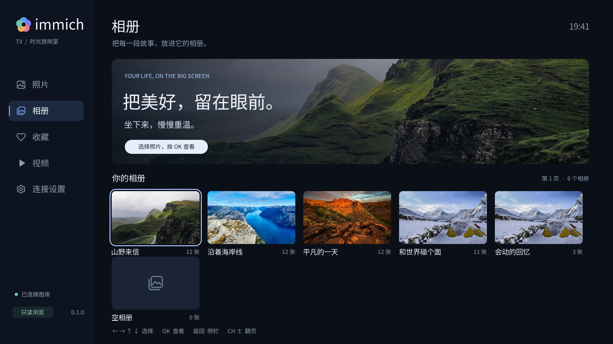
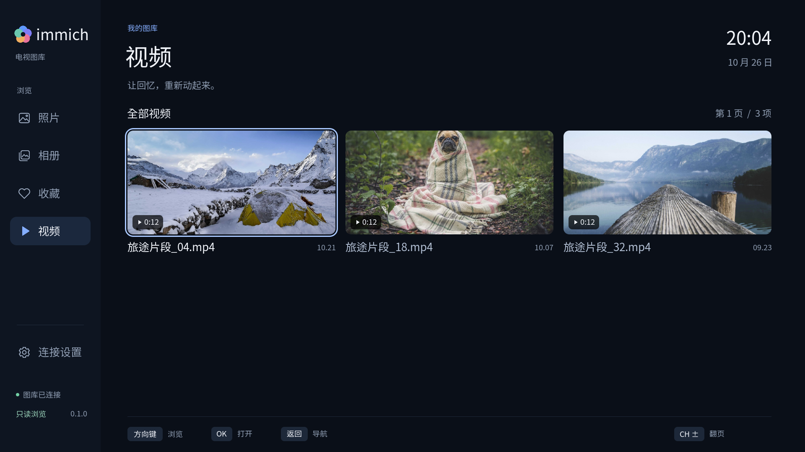
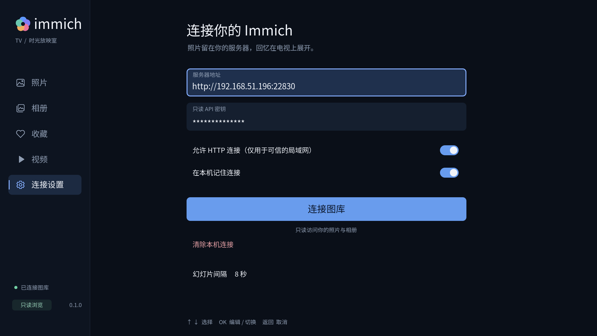
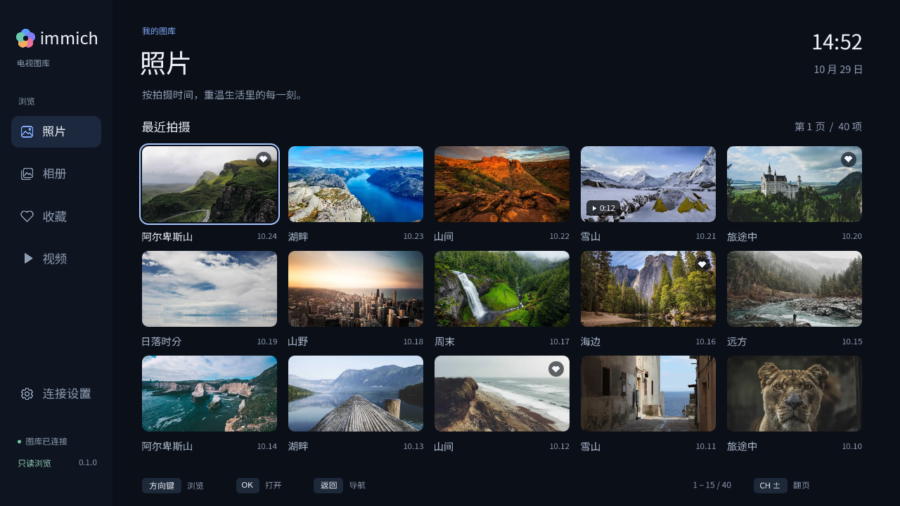

<div align="center">
  
  <h1>Immich LG TV</h1>
  <p>Your photos. Your television. Your own Immich library.</p>
  <p>
    
    
    
    
    <a href="LICENSE"></a>
  </p>
  <p>English · <a href="README.zh-CN.md">简体中文</a></p>
</div>

Immich LG TV brings your self-hosted photo library to LG webOS televisions.
Browse photos, albums, favorites, and videos with your remote, open a photo
full screen, or settle into a slideshow. Your media stays on your Immich server.

The interface runs natively in C and SDL2. Videos are demuxed in the app and
sent to the television's hardware player. Access is read-only: the client does
not upload, delete, rearrange albums, or change favorites.

## Screenshots

Captured from the native application on an **LG OLED48C4**, using a local
Immich-compatible fixture library. These are real application screens.


<details>
<summary>Albums, videos, and connection settings</summary>





</details>

<details>
<summary>Current modular build — desktop SDL capture, 2026-10-29</summary>



</details>

Capture details and commands: [Screenshots](docs/screenshots/README.md).

## Quick Start

### 1. Prepare your television

Install LG's **Developer Mode** app, sign in, enable **Dev Mode Status**, and
enable **Key Server** after the reboot. Pair your TV with the
[webOS CLI](https://webostv.developer.lge.com/develop/tools/cli-installation).
Keep your developer-mode session active while using sideloaded applications.

### 2. Install the native app

Build an IPK locally using the [development guide](docs/development.md), or
manually run the repository's **Manual CI** workflow with
**Build the ARM webOS IPK** enabled. Its `immich-lg-tv-webos-package` artifact
contains the IPK and corresponding FFmpeg sources.

```sh
ares-install -d lgtv dist/com.immichtv.viewer_0.1.0_arm.ipk
ares-launch -d lgtv com.immichtv.viewer
```

Replace `lgtv` with your paired device name. The application ID remains
`com.immichtv.viewer` so existing installations and saved connections can upgrade.
The project, native executable, and displayed app name are **immich-lg-tv**,
**immich-lg-tv**, and **Immich LG TV** respectively.

### 3. Connect your library

Enter your Immich server address and an API key in the app. Grant the key
`asset.read`, `asset.view`, and `album.read`. Upload, edit, delete, and
`asset.download` permissions are not required.

HTTPS validates certificates. For a trusted local network, explicitly enable
HTTP in connection settings. The key is sent in an `x-api-key` header; it never
becomes part of a media URL. Saving the connection on the TV is optional.

### 4. Try it without an Immich server

The included fixture service provides public demo photos, synthetic asset
records, albums, and short test videos. It is a small API-compatible test service,
not a full Immich installation.

```sh
python3 -m venv .venv
.venv/bin/python -m pip install -r requirements-dev.txt
make fixtures
make demo
```

Connect the TV to `http://YOUR_COMPUTER_IP:22830`, use the public fixture key
`immich-tv-demo`, and allow HTTP. The computer and service must stay available.
For deterministic tests without photo downloads, use
`make fixtures FIXTURE_ARGS=--offline` instead.

## Highlights

| Feature | What it does |
| --- | --- |
| A photo-first television layout | Photos and favorites use a 5 × 3 grid; albums and videos use larger three-column covers. |
| Built for the remote | Directional focus, OK, Back, channel paging, and LG Magic Remote pointer support. |
| Full-screen memories | Previous/next photos, metadata, centered zoom, and a timed slideshow of the current page. |
| Native video playback | FFmpeg handles the container and bitstream; LG hardware handles video playback. |
| Read-only by design | An explicit request policy permits media reads and metadata searches, with no content mutations. |
| Clear controls | SVG icons, antialiased rounded cards, consistent text alignment, and an on-screen keyboard. |
| Local connection storage | Optional app-owned credentials stored with `0600` permissions; no cloud account required by the client. |
| Manual builds | GitHub Actions runs only through `workflow_dispatch`; pushes and pull requests do not start CI. |

## Controls

| Remote | Action |
| --- | --- |
| Direction keys | Navigate the sidebar and cards; switch photos in full screen. |
| OK | Open an item; start/pause a slideshow or video. |
| Back | Close the keyboard or player, return to the gallery, then return to navigation. |
| Up / Down in a photo | Show information / toggle centered zoom. |
| Left / Right in a video | Seek backward / forward by 10 seconds. |
| CH + / − | Change the current API page. |

## Compatibility

Version **0.1.0** has been installed and checked on an LG OLED48C4 with webOS
platform **11.2.0**. The interface is currently Simplified Chinese and renders at
1920 × 1080. The native video window requires webOS 5 or newer.

API contracts target Immich 2.x and 3.x, including page and cursor pagination.
Verification uses the official Immich v3.3.5 OpenAPI contract and the included
fixture service; a full production Immich deployment has not yet been tested.
H.264 + AAC playback copies are the verified compatibility path. HDR, Dolby
Vision, Live Photos, AV1/VP9, and multiple audio-track selection remain unverified.

## Docs

- [Build, test, capture screenshots, and run manual CI](docs/development.md)
- [Module boundaries and ownership](docs/architecture.md)
- [Agent guidelines and commit-message policy](AGENTS.md)
- [Repository labels](.github/labels.json)
- [Third-party notices](NOTICE.md)

## License

Original project code and artwork are **MIT licensed**. See [LICENSE](LICENSE).
Third-party components retain their own licenses.

**The current webOS executable is still subject to GPL-3.0-or-later** because it
incorporates the PlxNative adapter. The MIT license does not relicense that
adapter or the combined executable. See [License scope](docs/licensing.md).

This is an independent, unofficial client. It is not affiliated with Immich,
FUTO, LG, Plex, or PlxNative. The native media adapter is derived from
[PlxNative](https://github.com/GLinnik21/plx-native); component attribution and
FFmpeg source-distribution details are documented in [NOTICE.md](NOTICE.md).
