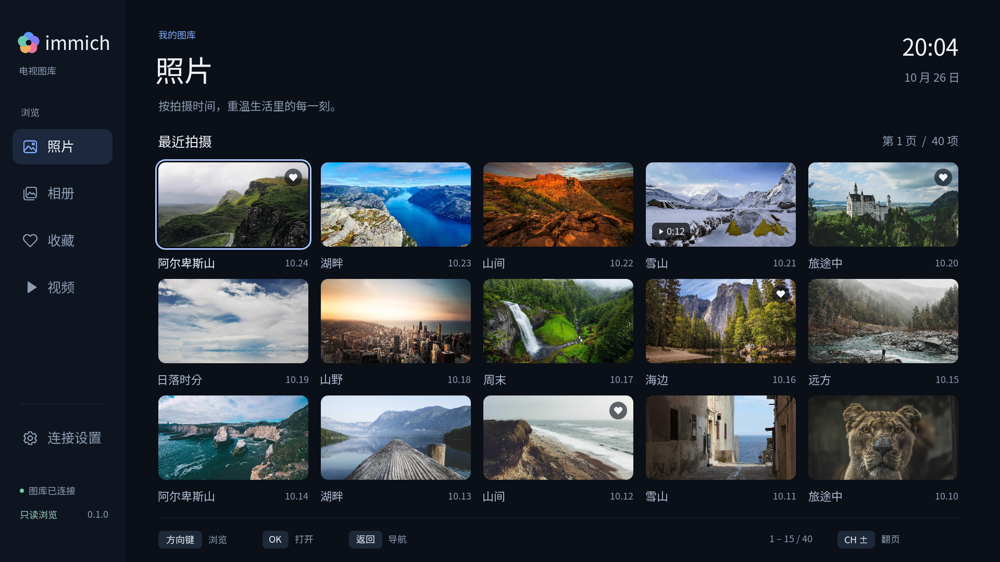

[English](README.md) · 简体中文

# Immich LG TV

LG webOS 原生、只读的 Immich 客户端。适合坐在沙发上用遥控器浏览自己的照片、相册与视频。

当前版本 **0.1.0**。已在 LG OLED48C4PCA、webOS 平台 11.2.0 上安装和验证。
参考 [PlxNative](https://github.com/GLinnik21/plx-native) 的原生渲染与硬件播放架构，
复用了其 GPL 原生媒体 ABI 适配器；图库接口、页面、状态、焦点与测试服务独立实现。



## 已实现

- 按拍摄时间倒序浏览照片，分页读取；兼容 Immich 2.x 页码与 3.2+ 游标。
- 相册、已有收藏、视频分类；收藏仅查看，不修改。
- 全屏照片、上一张 / 下一张、信息面板、居中放大、定时幻灯片。
- 遥控器方向键 / OK / 返回，LG Magic Remote 指针，桌面键盘。
- API 密钥连接、原生屏幕键盘、本机记住连接与清除连接。
- SVG 矢量图标、抗锯齿圆角卡片和按钮；按钮、导航与键盘按实际字形边界对齐。
- 照片 / 收藏为 5 列 3 行，相册 / 视频为 3 列大封面；设置采用分栏布局。
- 视频在应用内解析 MP4/MKV 容器，以 H.264 / HEVC 和 AAC / AC3 / EAC3
  数据送入 LG 硬件播放接口。视频不是在网页中播放。
- 对服务器不上传、不删除、不改相册，不写收藏或其他媒体状态。

## 试用

开发环境中已生成安装包 `dist/com.immichtv.viewer_0.1.0_arm.ipk`。
安装方式与 PlxNative 一样，电视需开启 Developer Mode。

```sh
ares-install -d lgtv dist/com.immichtv.viewer_0.1.0_arm.ipk
ares-launch -d lgtv com.immichtv.viewer
```

第一次打开进入连接设置。填入 Immich 地址与 API 密钥。
从 Immich 账户设置创建密钥时，至少授予 `asset.read`、`asset.view`、`album.read`。
`asset.download`、上传、编辑、删除权限均不需要。支持服务器地址带 `/api`
或反向代理子路径，应用会规范化地址。

默认使用 HTTPS 并校验证书。HTTP 需要在连接设置中明确允许，适合可信局域网测试。
服务端重定向不会携带密钥跟随；请填写最终地址。没有关闭证书验证的选项。

“在本机记住连接”默认关闭。开启时连接以本应用所有、模式 `0600` 的文件保存，
位于 `/media/developer/temp/com.immichtv.viewer/connection.json`，父目录为 `0700`。
这是文件权限保护，不是硬件加密。清除连接只删除本机凭据。

| 操作 | 行为 |
| --- | --- |
| 方向键 | 侧栏、网格导航；全屏时左右切换照片 |
| OK | 打开照片 / 相册；照片中开始或暂停幻灯片；视频中播放 / 暂停 |
| 返回 | 关闭键盘、停止视频、退出全屏、返回相册或侧栏 |
| 全屏照片 ↑ / ↓ | 信息面板 / 居中放大与还原 |
| 视频 ← / → | 后退 / 前进 10 秒 |
| CH ±；桌面 Page Up / Down | 前后翻页 |
| 桌面 R | 刷新当前页面 |

## 本地测试服务

`tools/mock_immich.py` 是按官方 API 合约实现的**最小兼容测试服务**，不是完整的
Immich Server。它没有数据库，不访问私人照片，也不接收上传。
包含 47 个合成资源记录、6 个相册、空相册、已有收藏和视频资源。
实际媒体由 20 张公开测试照片与生成的 H.264 视频组成。

```sh
python3 -m venv .venv
.venv/bin/python -m pip install -r requirements-dev.txt
make fixtures
make demo
```

默认监听 `0.0.0.0:22830`，电视和电脑需在同一个局域网。电视中填电脑的局域网 IP，
API 密钥使用公开的测试值 `immich-tv-demo`，允许 HTTP。
电脑上可通过 `http://127.0.0.1:22830/health` 查看健康状态与写入请求计数。
电脑休眠或停止服务后，电视无法继续访问这个演示图库。

电脑已有 `ares` 配对时，也可执行 `.venv/bin/python tools/run-demo-tv.py`，自动选取
电视所在网段的电脑地址并启动公开演示账号。

桌面原生预览：

```sh
brew install sdl2-compat sdl2_ttf sdl2_image ffmpeg pkgconf
make host
build/immich-lg-tv --server http://127.0.0.1:22830 --api-key immich-tv-demo --allow-http
```

命令行中的密钥仅用于这个公开演示值。真实密钥请在应用连接界面输入。
桌面视频预览调用外部 `ffplay` 窗口；电视版使用应用内硬件播放。

## 构建电视安装包

需要 macOS 上的 webosbrew NDK（默认目录 `~/webos-ndk/arm-webos-linux-gnueabi_sdk-buildroot`）。
`tools/setup-sdk.py` 下载并校验固定版本，再执行 SDK 的路径重定位。

```sh
python3 tools/setup-sdk.py
make ipk
python3 tools/verify-release.py
```

电视产物为 ARMv7 soft-float ELF。使用 `-tno-glibc-polyfill` 排除 NDK 的兼容归档，
直接链接系统 ABI。FFmpeg 共享库来自已核验的 PlxNative v0.9.0，
源代码归档与原始构建脚本在 `dist/` 中随 IPK 一同交付。

`make QA=1 host` / `make QA=1 ipk` 另外构建带确定性按键脚本与截图功能的测试二进制，
文件名带 `-qa`。正式构建不接受这些测试参数。
普通 `make ipk` 始终使用正式二进制，避免误交付测试构建。

## 验证与边界

```sh
make test
```

测试覆盖只读请求白名单、路径注入、密钥失效、子路径代理、2.x / 3.x 分页、相册筛选、
空相册、凭据权限、HTTP Range、视频转 Annex B、AAC 转 ADTS、到达 EOF 后跳转与中途取消。
电视上的字体、全屏布局与视频画面另做实机验证；用户已确认可见视频画面。

兼容性以 **Immich v3.3.5 官方 OpenAPI 与最小测试服务**为依据。
尚未连接完整的生产 Immich 服务器，不能把兼容测试等同于所有真实部署验证。
本版界面与照片预览为 1920×1080；照片放大围绕中心，不提供手动平移。
幻灯片按当前分页播放，到达分页末尾时停止。
HDR、Dolby Vision、Live Photo、AV1/VP9 与多音轨选择不在本版验证范围。
使用 Immich 生成的 H.264 + AAC 播放副本作为兼容路径。
当前原生视频窗口绑定要求 webOS 5+；更老型号未经验证。
开发者模式安装仍需在到期前执行 EXTEND，避免 LG 移除侧载应用。

源代码与第三方组件许可见 [NOTICE.md](NOTICE.md) 与 [LICENSE](LICENSE)。
设计说明见 [DESIGN.md](DESIGN.md)。
